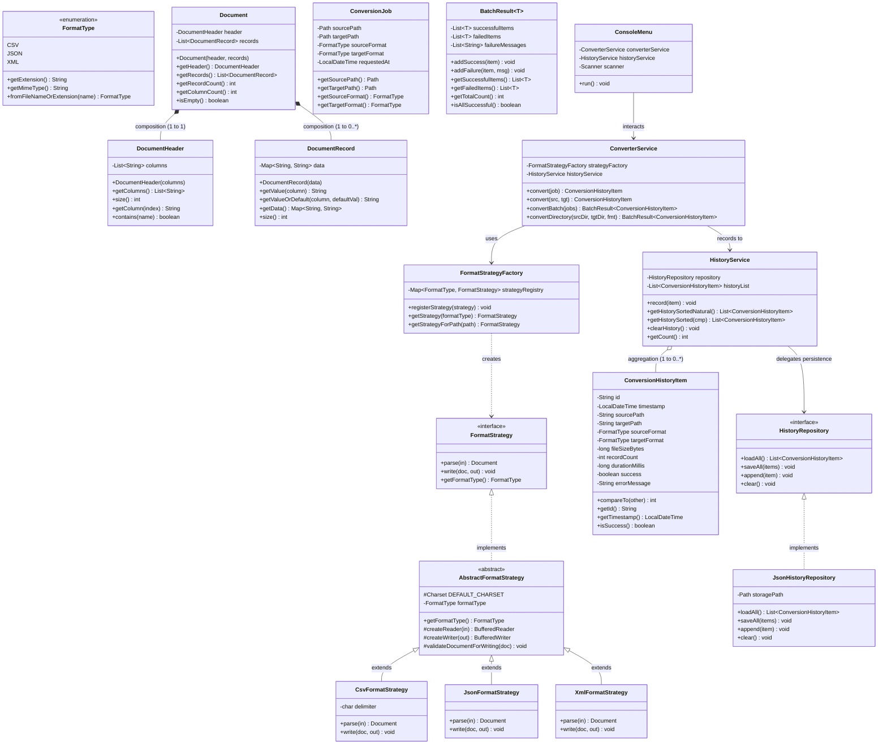

# UML Class Diagram - DataMorph File Converter

This document provides a viewable UML class diagram rendered with Mermaid. The editable PlantUML source is available at `docs/uml-class-diagram.puml`.

